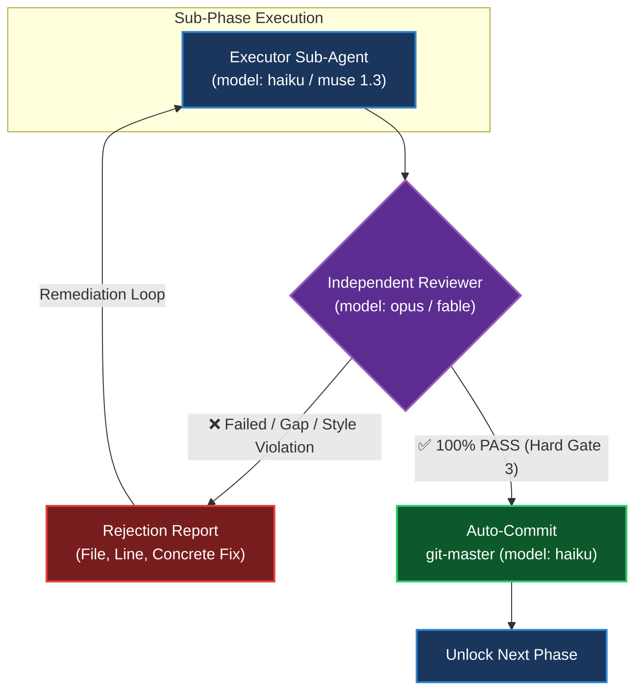

# PRD Blueprint Standard & Multi-Agent Architectural Governance

This document serves as the authoritative, stack-agnostic, single source of truth (SSOT) for drafting, parallel wave partitioning, strict TDD Red-Green-Refactor (RGR) discipline, live progress tracking, and post-execution metadata reconciliation for technical planning documents (**Master PRD / Blueprint**) across all ACS monorepo suites and buyer repositories adopting ACS workflows.

Reference implementation case study (100/100 score):  
👉 [`.claude/plans/cli-modernization-and-build-tag-isolation/index.md`](../../.claude/plans/cli-modernization-and-build-tag-isolation/index.md)

---

## 1. Planning Thresholds: Direct Execution vs Mandatory PRD

### ⚡ ZERO-SECOND REFLEX PROTOCOL (AUTOMATIC GATE EVALUATION)

At second zero of every code engineering instruction ('create', 'add', 'fix', 'upgrade', 'design', 'refactor', 'build'), the Lead Orchestrator MUST reflexively run an impact scan without asking:
1. Does the estimate touch more than 2 files?
2. Is the task heterogeneous / cross-module (e.g., Backend + Frontend, or SSOT Persona + Docs)?
3. Does the work contain sequential stages (multi-step)?

IF ANY CONDITION IS MET: the Lead Orchestrator is FORBIDDEN from entering brainstorming/consultation mode or coding directly. The Lead Orchestrator MUST REFLEXIVELY SPAWN THE ARCHITECT to author a PRD Blueprint.

IF NONE IS MET (<=2 files, 1 domain, <100 LOC): the Lead Orchestrator dispatches a Worker (haiku/sonnet) directly for Direct Execution.

### Direct Execution Agent Dispatch Contract (MANDATORY `direct_execution: true` Flag)

When a task satisfies ALL 5 Direct Execution criteria (<=2 files, 1 domain, <100 LOC, zero DB/DDL, zero API break), the Lead Orchestrator MUST include `"direct_execution": true` in the Agent `tool_input` (or include the prompt token `direct_execution: true`) so that `prd-workflow-gate` permits the dispatch. Example: `{"subagent_type": "executor", "direct_execution": true, "prompt": "..."}`. Providing an unapproved `blueprint_path` will ALWAYS be blocked by the anti-bypass guard regardless of direct execution claims — presence of `blueprint_path` voids the Direct Execution exemption and mandates blueprint approval validation.

Every agent (Lead Orchestrator and Worker sub-agent) MUST evaluate task scope before modifying any code or persistence layer:

### Strict Binary Decision Matrix

```text
                                  [INCOMING TASK]
                                         │
             ┌───────────────────────────┴───────────────────────────┐
             ▼                                                       ▼
   [DIRECT EXECUTION ALLOWED]                             [MANDATORY PRD PLANNING]
   (All 5 conditions MUST be met):                        (Triggered if ANY condition met):
   1. Domain Homogeneity (1 package/dir)                  1. Full-Stack Boundary (UI + Backend API)
   2. Target Files: 1 to 2 files (1 code + 1 test)        2. Scale: >= 3 files or multi-package
   3. Zero DB Schema / DDL Mutation                       3. Database Schema / DDL / Migrations
   4. Zero Shared Contract / Exported API Breaking        4. Daemon / Lifecycle / Path Resolution
   5. Diff Ceiling: < 100 LOC total                       5. 2-Strike Failure Escalation Circuit Breaker
             │                                                       │
             ▼                                                       ▼
   Worker (haiku/sonnet) -> TDD RGR -> Commit             Architect index.md -> Planner phase-*.md
```

| Task Conditions / User Request | Execution Policy | Mandatory Workflow |
|---|---|---|
| **Deterministic, domain-homogeneous (1 package/dir), <=2 files, <100 LOC diff, zero DB/DDL, zero exported contract break** | **Direct Execution** | Execute directly to completion without excessive planning. Apply TDD if altering behavior, provide verified empirical proof, commit atomically, and report. |
| **Full-stack changes (UI + API), >=3 files, database schema/DDL, daemon/lifecycle modifications, or failure escalation (2-strike)** | **Mandatory PRD Planning** | **MUST** draft a structured modular PRD in the local project repository: `.claude/plans/<suite-name>/` (`index.md` by Architect, `phase-*.md` by Planner) before initiating implementation code. |

### 1.1 Blueprint Execution Readiness Protocol: Direct Wave Dispatch vs Mandatory Baseline Re-Audit

Before dispatching an existing PRD Blueprint (`.claude/plans/<suite-name>/`) to a Project Manager or Worker sub-agent for implementation, the Lead Orchestrator MUST evaluate whether the blueprint is execution-ready or mandates a baseline re-audit against live AST ground-truth:

#### A. Fast-Path Direct Wave Dispatch (Zero Re-Audit Required)
Direct execution dispatch to PM/Workers is permitted ONLY IF ALL 3 conditions are met:
1. **Freshness Window**: The blueprint was authored, revised, or audited within the last < 24 hours in the active sprint.
2. **Current Certified Confidence Score ≥ 97%**: Already carries an empirical STAMP OF APPROVAL from Critic/Architect with live disk AST proofs.
3. **Zero Underlying Codebase Drift**: Target files, packages, and dependency contracts have NOT undergone structural refactoring in `git log` since the blueprint was finalized.
*Action*: Directly dispatch Wave 1 to PM/Worker for immediate TDD execution!

#### B. Mandatory Baseline Re-Audit & PRD Refresh (Pre-Execution Re-Audit Gate)
The Lead Orchestrator MUST STOP and spawn an independent Architect/Critic (`model: opus`/`fable`) to re-audit live disk AST ground-truth before writing code IF ANY of these conditions occur:
1. **Stale Blueprint Threshold (>48 Hours or Cross-Milestone/Cross-Version)**: The blueprint was drafted in a previous version era (e.g. pre-v1.20.0 Jinja2, pre-v1.21.0 Session Bus) and may reference obsolete paths, retired APIs, or superseded patterns.
2. **Underlying Codebase Mutation**: Target packages or contracts have been modified on `main`/`dev` since the blueprint was authored.
3. **Altered Strategic Directives / New Architectural Invariants**: Founder/User provides new constraints (e.g. "must be stack-agnostic", "multi-project support", "dynamic identity resolution", "bounded 25KB payloads").
4. **Sub-Threshold Confidence Score (<97%)**: The blueprint lacks empirical ground-truth citations, measurable KPIs, or concrete E2E scenarios.
5. **Execution 2-Strike Circuit Breaker**: Any worker sub-agent fails 2 consecutive execution turns due to discrepancy with actual disk files.
*Action*: Re-audit live disk, update sub-phase files, recalibrate confidence score to ≥97%, then dispatch!

### 1.2 Concrete Ground Truth Input Gate (Audit-First Architect Dispatch Invariant)
The Lead Orchestrator is STRICTLY FORBIDDEN from dispatching the Architect sub-agent (Opus/Fable) with open-ended repository sweep instructions ("search and design from scratch").
Before invoking the Architect to draft a PRD Blueprint:
1. **Audit-First Ground Truth Extraction**: The Lead Orchestrator or Auditor MUST extract concrete ground truth physical evidence (target files, exact line numbers, existing struct names, and concrete gaps) in <60 seconds.
2. **Audit Evidence Packet**: All physical evidence must be bundled into an Audit Evidence Packet and injected directly into the Architect's dispatch prompt.
3. **Synthesis Role Primacy**: The Architect sub-agent is strictly tasked with architectural synthesis, type contract design, modular wave partitioning, and test scenario formulation—NOT exploring disk from scratch.

### Architectural Triggers & Circuit Breakers (MANDATORY PRD ENFORCEMENT)

Even if a task appears compact, the following three conditions MANDATE a Master PRD Blueprint:

1. **Full-Stack Barrier**: Any task touching both Frontend UI (SolidJS/React/Vue/TSX) and Backend API (Go/Node/Python endpoints) MUST use a Master PRD Blueprint. Single-run direct execution is strictly prohibited across the full-stack boundary.
2. **Daemon Risk Barrier**: Any task modifying service lifecycle (startup, shutdown, restart, supervise), path resolution (`cliconfig`, binary paths, directory resolvers), or embedded static bundle pipelines (`stage-embed`, Go `embed.FS`) MUST use a Master PRD Blueprint.
3. **Failure Escalation Circuit Breaker**: If a direct execution attempt or targeted fix fails 2 consecutive times (test failure, compile error, or runtime regression), the agent MUST IMMEDIATELY STOP and author a structured Master PRD before attempting further code modifications. Blind 3rd-attempt patching is strictly forbidden.

### ⛔ STRICT PROHIBITION: Built-in `EnterPlanMode`
- **DO NOT invoke `EnterPlanMode`**: The built-in Claude Code CLI plan mode persists plans in a random global directory (`~/.claude/plans/<random-slug>.md`), disconnects from project git version control, and destroys modular multi-phase architecture.
- All technical architecture documents **MUST** be authored directly in the local repository: `.claude/plans/<suite-name>/index.md` alongside modular sub-phases (`phase-01-*.md`, etc.).
- Agents operate in normal execution / bypass-permissions mode without getting trapped in `EnterPlanMode` loops.

### ⛔ HARD GATE: MANDATORY RE-AUDIT & TOPOLOGY REVIEW PRIOR TO REPORTING
After the Master PRD (`index.md`) and all sub-phase files (`phase-01-*.md`, etc.) are authored, agents **MUST EXECUTE THE FOLLOWING 2 CLOSING GATES BEFORE CONTACTING THE USER**:

1. **Stage 1: Mandatory Sub-Agent Re-Audit & Topological Partitioning**:
   - The Orchestrator **MUST spawn an independent sub-agent** (`oh-my-claudecode:architect`, `oh-my-claudecode:critic`, or `Explore`) to perform an exhaustive re-audit:
     - **Baseline Codebase Ground-Truth Check**: Verify architectural blueprints against current disk and AST ground truth (`manifest.json`, actual source files), NOT stale memory or historical notes.
     - **Confidence Success Score ≥ 97%**: The sub-agent MUST assess if the execution success confidence score exceeds **97%**. If below 97% or if logical gaps exist, the blueprint MUST be revised before submission.
     - **Deterministic Targets & Measurable KPIs**: Ensure each sub-phase contains concrete deliverables, strict TDD RGR scenarios (RED ➔ GREEN ➔ REFACTOR), and empirical KPIs.
     - **Parallel Waves**: Partition tasks touching isolated files (*air-gapped*) for safe simultaneous multi-agent execution without merge conflicts.
     - **Sequential / Single-Threaded Phases**: Identify phases modifying shared state (database schemas, central routers, shared types) that MUST run sequentially.
     - **Dependency & Blocker Mapping**: Explicitly map inter-phase blockers (e.g., *Phase 02 blocked until Phase 01 completes table migration*).
   - All sub-agent audit findings **MUST be explicitly recorded** in the Metadata Header (`Confidence Score: ≥97%`), DAG Mermaid Diagram, and Wave Table of `index.md`.

2. **Stage 1B: Mandatory Post-Review Re-Audit Loop**:
   - Whenever a PRD blueprint is updated or revised after receiving user review, feedback, or altered directives:
     - The agent is **STRICTLY FORBIDDEN from asking for approval directly from the Division PM (Hard Gate 2 routine)** or assuming revisions are valid without an independent re-audit.
     - The Lead Orchestrator **MUST spawn an independent sub-agent** (`oh-my-claudecode:architect` or `oh-my-claudecode:critic`) to re-audit the updated blueprint against live disk AST ground truth.
     - The Confidence Success Score **MUST genuinely reach ≥ 97%** before the blueprint may be submitted to the Division PM for confirmation (routine) or to CEO Anke (cross-cutting).
     - This cycle repeats Stage 1 ➔ Stage 1B until the blueprint is 100% complete before requesting execution approval from the Division PM (routine) or CEO Anke (cross-cutting).

### 🏛️ Hierarchical Two-Tier Planning & Phase-per-Phase Blueprint Review (MANDATORY PRD WORKFLOW)
To eliminate high-reasoning token waste (~60-70% savings) and catch blindspots at the first second before downstream phases are authored, PRD construction MUST follow the Two-Tier Planning architecture:
1. **Tier 1 (Master Architecture & Contract)**: Lead Architect (`model: opus` / `fable`) authors ONLY the Master PRD `index.md` (System Context, Component Tree, API Contracts, DAG Waves, and Measurable KPIs). Token budget: ~25k-35k tokens.
2. **Tier 2 (Modular Sub-Phase Writing)**: Blueprint Writer (`model: haiku` / `muse 1.3`) authors individual sub-phase documents (`phase-01-*.md`, `phase-02-*.md`, etc.) adhering strictly to the contracts established in `index.md`. Token budget: ~15k tokens per phase on lightweight models.
3. **Tier 3 (Phase-per-Phase Blueprint Review Gate)**: An independent reviewer/critic (`model: opus` / `fable`) immediately reviews and audits each sub-phase blueprint upon completion, catching blindspots at the first second before downstream phases are authored. Token budget: ~15k tokens per review.
4. **Economic & Quality Invariant**: Slashes high-reasoning token consumption by 60%–70%, eliminates monolithic PRD review fatigue, and intercepts blindspots immediately at the phase boundary.

3. **Stage 2: STOP & Request Division PM / CEO Approval (Zero Execution Before Approval)**:
   - The Orchestrator **MUST IMMEDIATELY STOP** and present the architectural summary, sub-agent re-audit score, wave execution map, and phase breakdown to the Division PM (routine) or CEO Anke (cross-cutting), explicitly requesting formal review and approval from the Division PM (routine) or CEO Anke (cross-cutting).
   - **DO NOT proceed directly to implementation code** (spawning coding tasks, editing source files, or altering databases) before explicit PM/CEO confirmation! Founder (Pak Andy) is never in the approval path. Direct execution without approval is only permissible if the initial prompt explicitly instructed: *"execute without review"*.

4. **Stage 3 (During Execution): Mandatory Per-Wave Validation Gatekeeper & Feedback Loop (Verifier as Execution Supervisor)**:
   - Execution proceeds wave-by-wave following the approved DAG.
   - Throughout wave execution, the Lead Orchestrator strictly enforces the Watchdog Governance Protocol (`orchestrator-subagent-watchdog.md`): 3-minute heartbeat checks, 15-minute SLA ceiling, and 2-strike intervention ladder before wave completion gatekeeping.
   - **Upon completion of all worker sub-agents within a Wave**, the Lead Orchestrator **MUST NOT proceed to the next Wave**.
   - The Lead Orchestrator **MUST spawn the Verifier (`oh-my-claudecode:verifier`, `model: opus`, `task_load_tier: standard`) acting as Execution Supervisor** leading the wave inspection (supported by `qa-tester` / `test-engineer` evidence when needed) to validate the Wave's output:
     - **Independent Verification**: Run project test suites (`go test`, `bun test`, `pytest`, `cargo test`), typecheckers (`tsc --noEmit`, `go build`), and linters independently.
     - **Blueprint & DoD Compliance**: Verify that deliverables satisfy all Definition of Done (DoD) criteria in the corresponding sub-phase documents.
     - **Zero-Regression & Parity**: Ensure existing tests have not regressed.
     - **Atomic Git Commit & Clean Working Tree Audit (HARD REQUIREMENT)**:
       Gatekeeper MUST verify via `git status --porcelain` that all modified files belonging to the phase have been committed to local git with conventional commit formatting (`feat(...): ... (phase-XX)`). Gatekeeper **MUST REJECT (FAIL)** any wave if files remain dirty/uncommitted.
   - **Deterministic Rejection & Self-Healing Feedback Routing**:
     - If failures, regressions, or blueprint deviations occur:
       a) Gatekeeper issues a concrete rejection report (File, Line, Failure Scenario, Expected vs Actual, Log snippet).
       b) Orchestrator routes the defect directly back to the worker sub-agent that authored the phase to retain development context.
       c) Worker repairs the issue following TDD RGR.
       d) Gatekeeper re-tests until 100% GREEN.
     - **Next Wave remains LOCKED** until Gatekeeper certifies `VERDICT: APPROVED / PASS (100%)`.
   - **⛔ SINGLE-CHUNK DISPATCH INVARIANT (MANDATORY)**: The Lead Orchestrator is STRICTLY FORBIDDEN from batching multiple chunks into a single agent prompt. Exactly ONE chunk (1-2 files max, 1 domain) per sub-agent dispatch turn. Each chunk must be executed, verified, and committed before the next sequential chunk is dispatched. Never ask a worker to handle Chunk 1 and Chunk 2 simultaneously.
   - **⛔ POST-WORKER VERIFICATION INVARIANT (MANDATORY)**: Whenever a worker sub-agent completes a task (whether Direct Execution or Phase Wave), the Lead Orchestrator is STRICTLY FORBIDDEN from reporting completion to the user or closing the task list immediately. The Lead Orchestrator MUST spawn an independent Verifier sub-agent (model: opus) to conduct an empirical audit. A completion report MAY ONLY be submitted to the user after receiving an explicit STAMP OF APPROVAL (PASS) from the Verifier.
   - **Final Blueprint Parity & Live E2E Gate**:
     - On the final Wave, the Verifier validates live runtime health (smoke tests, service probes, zero orphaned files) before reconciling PRD status to `✅ COMPLETED / DONE`.

### 🔄 4-Stage Inner Circle Pipeline (User Intent ➔ Approval)
PRD authoring for the Lead Orchestrator's Inner Circle follows a strict 4-stage pipeline (Stage 0 through Stage 4). Each stage MUST complete before the next begins; skipping a stage is strictly forbidden:

| Stage | Name | Actor | Output / Exit Criteria |
|---|---|---|---|
| **Stage 0** | User Intent | User + Lead Orchestrator | Raw user request captured as the authoritative intent statement. |
| **Stage 1** | Auditor Baseline Audit | Auditor sub-agent | Baseline verified against live disk/AST ground truth; findings recorded. |
| **Stage 2** | Blueprint Writer Drafting | Blueprint Writer sub-agent | Master PRD `index.md` + modular sub-phase documents drafted per contracts. |
| **Stage 3** | Hard Gate 1 Re-Audit | Independent `architect` / `critic` sub-agent | Confidence Success Score ≥ 97% achieved against live disk AST ground truth. |
| **Stage 4** | Hard Gate 2 Approval | Division PM (routine) / CEO Anke (cross-cutting) | Explicit formal approval granted; execution unlocked. Founder is never asked. |

Flow: `Stage 0 (User Intent) -> Stage 1 (Auditor Baseline Audit) -> Stage 2 (Blueprint Writer Drafting) -> Stage 3 (Hard Gate 1 Re-Audit) -> Stage 4 (Hard Gate 2 Approval by Division PM / CEO Anke)`.

- Revisions after Stage 4 loop back to Stage 1 (Hard Gate 1B re-audit) — never skip directly to Stage 4.
- Stage 1 MUST precede Stage 2: drafting against an unaudited baseline is strictly forbidden.

### 🧬 Roadmap Rules & Skills Go Binary SSOT (Zero-Drift Thin-Shim Runtime)
All governance rules (`.agents/rules/*.md`) and skills (`skills/*.md`) are embedded directly into the `acs` Go binary as the single source of truth (SSOT):

- **Query commands**: `acs rule cat <rule-name>` prints a rule's full content from the embedded FS; `acs skill run <skill-name>` executes/renders an embedded skill — both served entirely from the compiled binary with zero on-disk drift.
- **Zero-Drift Thin-Shim Runtime**: On-disk rule/skill files act only as thin shims/build inputs. The embedded binary copy is authoritative at runtime, guaranteeing every agent instance (dev/staging/prod) reads an identical ruleset regardless of local filesystem state.
- **Sync Invariant**: Any change to `.agents/rules/` or `skills/` MUST be rebuilt into the binary (e.g., `just embed-stage` + `just build`) so the SSOT never diverges from the repository source.

### ⛔ PRD BLUEPRINT CLEAN WORKING TREE COMMIT INVARIANT
Whenever a PRD blueprint is created, updated, or marked completed in `.claude/plans/<suite>/`, agents MUST immediately stage and commit all `.claude/plans/<suite>/*.md` files as `docs(plans): <suite> ...` with a rich semantic body. Leaving uncommitted or untracked `.claude/plans/` markdown files in the working tree after completing a phase or task is strictly forbidden. Working tree must remain 100% clean at all phase boundaries.

---

## 2. Directory Structure & Modular File Hierarchy

Monolithic planning documents (>500 lines) that exhaust context windows are strictly forbidden. Every plan MUST be decomposed into modular units:

```text
.claude/plans/<suite-name>/
├── index.md                                  ← Master PRD Blueprint (Control Map, Wave Matrix & DAG)
├── phase-01-<sub-topic-slug>.md              ← Self-contained Technical Spec Phase 1 (Air-gapped)
├── phase-02-<sub-topic-slug>.md              ← Self-contained Technical Spec Phase 2 (Air-gapped)
├── ...
└── phase-NN-<sub-topic-slug>.md              ← Self-contained Technical Spec Phase N (Air-gapped)
```

---

## 3. Master PRD Standard Format (`index.md`)

The `index.md` document serves as the **Orchestrator Control Map** and MUST contain 8 standardized sections:

### 1. Structured Metadata Header
```markdown
# <Suite Name> — Master PRD

**Target Repository:** <path-to-target-repo-or-sub-apps>  
**Technology Stack:** <complete-stack-list-e.g.-Go-1.26,-SolidJS,-Tailwind,-SQLite,-Python>  
**Author:** Andy Vandaric & Lead Orchestrator  
**Current Version:** `<semver-current-version-e.g.-v1.6.1>`  
**Target Release Version:** `<semver-target-version-e.g.-v1.7.0>` (<Bump Type: Patch|Minor|Major> — <one-line-scope-rationale>)  
**Status:** 🟡 PROPOSED / 🔄 IN PROGRESS (X/Y PHASES COMPLETED) / ✅ COMPLETED  
**Target Delivery:** Multi-Phase Modular Architecture  
**Created:** YYYY-MM-DD HH:MM (UTC±X) _(author local time + UTC offset, e.g. 2026-09-17 15:30 (UTC+7))_  
**Completed Date:** YYYY-MM-DD HH:MM (UTC±X) _(mandatory when status is ✅ COMPLETED)_  
**Duration:** Xh Ym _(computed duration: Completed − Created; if <1h use Xm Ys, if <1m use Ys)_  
**Last Updated:** YYYY-MM-DD HH:MM (UTC±X) _(author local time + UTC offset, e.g. 2026-09-17 20:50 (UTC+7))_  
**Verification Verdict:** <Evidence of 100% test pass, build status, 0 errors>  
**Next Milestone:** <Name of next wave / phase scheduled for execution>  
**Primary Keywords:** <technical and architectural keywords>  
```

### 2. 🎯 Executive Summary & Strategic Vision
- **Context & Core Pain Points** (Incidents, scaling limits, tech debt).
- **Architectural Vision** (Desired end state and measurable business outcomes).

### 3. 🎨 Visual & Interface Design: Before vs After
Every PRD MUST provide visual proof before and after:
- **CLI / Backend / Daemon / Engine Features**:
  - Web UI mockups are strictly forbidden.
  - MUST include:
    1. **ASCII Art Header & Brand Badge** (for CLI banner).
    2. **Terminal Interface Evolution (Before vs After)**: Concrete command output and log streams demonstrating zero-leak security flags, quickstart help, and rotating pro-tips.
- **Frontend / GUI / Web / Mobile Features**:
  - MUST include **Comprehensive Responsive ASCII Wireframes** (Desktop and Mobile <450px).
  - MUST map **8 visual interaction states**: `idle`, `hover`, `focus-visible`, `active`, `disabled`, `loading`, `empty`, `error`.
  - MUST follow W3C Design Tokens, 60-30-10 palette ratio, and 8pt grid (Zero AI-slop purple haze gradients).

### 4. 🌊 Parallel Multi-Agent Execution Waves (DAG Matrix)
To eliminate file edit collisions (*zero merge conflicts*) under concurrent multi-agent execution, all phases MUST be grouped into **Parallel Waves**.

#### 4a. Contract-First Parallel Waves (Vertical Slice with Frozen Contracts) — MANDATORY for Multi-Domain Features
Default method for features touching multiple domains (API + UI + Schema):
1. **Wave 1 — Freeze Contracts & DDL (Blocking)**: Write DDL migrations, define shared DTOs/interfaces (TS DTOs, Go structs, JSON schemas). Worker agents MUST NOT alter frozen contracts without lead re-approval.
2. **Wave 2A/2B — Parallel Execution without Collisions**: Backend and Frontend developed concurrently on top of frozen contracts.
3. **Wave 3 — Seamless Wiring & E2E Verification**: Connect UI to endpoints, run full verification suites with zero contract drift.

#### 4b. Air-Gapped Waves (File Boundary Isolation) — for Single-Domain Features
Partition phases based on exclusive file locks:
- Wave 1 (Backend Engine): `src/module_a/*`
- Wave 2 (Pipeline & Release): `tools/pipeline/*`, `scripts/`
- Wave 3 (Frontend): `apps/web/src/*`
- Final Gate (Lead Verifier): Full Test Suite & Parity Audit

### 5. 📋 Sub-Phase Breakdown Table (Air-Gapped Boundaries)
The phase breakdown table MUST enforce explicit file boundaries (*Exclusive File Lock Rule*):

| Phase | Title | File Plan | Target File Boundaries (Air-Gapped) | Parallel Wave | Status |
|---|---|---|---|---|---|
| **Phase 01** | ... | `phase-01-....md` | `src/module_a/*`, `src/types.ts` | **Wave 1 (Backend)** | ✅ **DONE** (Commit: `hash`) |
| **Phase 02** | ... | `phase-02-....md` | `tools/pipeline/*`, `scripts/` | **Wave 2 (Pipeline)** | ✅ **DONE** (Commit: `hash`) |
| **Phase 03** | ... | `phase-03-....md` | `apps/web/src/components/*` | **Wave 3 (UI)** | 🔄 **IN PROGRESS** |
| **Phase 04** | ... | `phase-04-....md` | Verification Gate (E2E, Parity, Leak Scan) | **Final Gate** | 🔲 **READY** (Blocked by W1-W3) |

### 6. 🎯 Measurable KPIs & Success Criteria (MANDATORY SECTION 6)
Every Master PRD Blueprint MUST include a dedicated quantitative KPI table defining objective success criteria:

| Dimension | Target Parameter | Baseline (Before) | Success Target (After) | Verification Method |
|---|---|---|---|---|
| **Performance / Latency** | Runtime or response duration | Current benchmark (e.g. 850ms) | Target SLA (e.g. < 200ms) | Automated benchmark or execution profiling |
| **Code Budget / Footprint** | Net lines of code / token density | Pre-refactor size | Target reduction (e.g. -35% tokens) | Static file count or LOC analysis tool |
| **Error Rate / Reliability** | Uncaught exceptions / error rate | Baseline rate (e.g. 15% errors) | Target zero (0 errors / 100% clean) | Automated log inspection and HTTP probe check |
| **Accessibility / Design** | Contrast ratio / interaction states | Unmeasured raw styles | WCAG AA >= 4.5:1 ratio | Automated accessibility audit or DOM query |

*Auditor sub-agents MUST reject any PRD lacking Section 6.*

### 7. 🧪 Concrete End-to-End Test Scenarios (MANDATORY SECTION 7)
Every Master PRD Blueprint MUST specify explicit Given-When-Then test scenarios covering the primary execution pathways:

```markdown
### Scenario 1: <Primary Workflow / Happy Path>
1. **Given**: <Initial system state, configuration, and environment prerequisites>.
2. **When**: <User action, API call, or CLI invocation takes place>.
3. **Then**:
   - <Expected state mutation, return payload, and status code>.
   - <Assertion of zero unexpected side-effects or regressions>.

### Scenario 2: <Error Recovery / Edge Case>
1. **Given**: <Degraded environment, invalid payload, or boundary condition>.
2. **When**: <Failure-inducing operation occurs>.
3. **Then**:
   - <Graceful error response, structured fallback, and recovery verification>.
```

*Auditor sub-agents MUST reject any PRD lacking Section 7.*

### 8. 📦 Artifact Contract & Verification Matrix (Input ➔ Action ➔ Evidence)
Deterministic matrix binding inputs, actions, and verifiable evidence per phase:

| Wave & Phase | Input Artifact | Agent Execution Action | Verifiable Evidence |
|---|---|---|---|
| **Wave 1: Phase 01** | `src/types.ts` | TDD test suite & type implementation | Unit tests 100% pass; string leak scan 0 matches; zero compiler warning. |

---

## 4. Sub-Phase Standard Format (`phase-XX-*.md`)

Each sub-phase document is a self-contained execution specification:

1. **Header Metadata**:
   - `**Parent PRD:** [index.md](./index.md)`
   - `**Status:** 🟡 READY / 🔄 IN PROGRESS / ✅ DONE`
   - `**Completed Date:** YYYY-MM-DD`
   - `**Target Codebase:** <air-gapped file list>`
   - `**Verification:** <test command & summary>`
2. **🎯 1. Objective & Explicit Non-Goals**:
   - Concrete objectives and strict out-of-scope boundaries (*Scope Guard*).
3. **🏛️ 2. Architectural Specification**:
   - Algorithms, data contracts, function signatures, and state machine diagrams.
4. **🎨 3. Visual & Interface Design**:
   - Terminal stream output for CLI/backend OR responsive 8-state ASCII wireframes for frontend UI.
5. **🧪 4. Test Strategy & TDD Red-Green-Refactor (HARD RULE)**:
   - Adhere strictly to the canonical TDD Red-Green-Refactor protocol in `.agents/rules/backend-engineering-discipline.md`:
     - **Step 1 (RED)**: Define expected behavior and author the minimal failing test.
     - **Step 2 (GREEN)**: Write the minimal implementation to achieve passing tests.
     - **Step 3 (REFACTOR)**: Remove duplication and enforce file/function limits while keeping tests green.
   - **Regression Guard Assertion**: Add regression assertions for all bug fixes.
   - **Anti-Test Tampering**: NEVER weaken, delete, or bypass failing test assertions.
6. **📦 5. Micro-Chunk Dispatch Units (MANDATORY for 2+ Files or Cross-Package)**:
   - **Core Philosophy**: Embody the Micro-Chunk principle across all blueprints, agents, and models: *"Fast, effective, efficient, precise, low-cost high-impact, minimal resource usage, proven before built, reused before created"*.
   - **P9 Micro-Chunk Decomposition Rule**: Sub-phases targeting 2+ files or multiple package boundaries MUST decompose work into pre-packaged, single-responsibility Micro-Chunks.
   - **Domain Homogeneity Invariant (Anti-Mixed-Domain Rule)**: Each micro-chunk dispatch payload MUST strictly belong to a single, homogeneous architectural domain. Never mix Go backend packages, JavaScript/Node.js hooks, and Markdown PRD files within the same sub-agent turn. Mixing domains forces context-switching across divergent toolchains/runtimes and dilutes the model's focus.
   - **Hard Ceiling on Payload Scope for Lightweight Models**: Hard limit of at most 1-2 files per chunk (1 core implementation file + 1 unit test, or 2 tightly-coupled files within the same directory/package). Target turn duration: 30-60 seconds; hard timeout: <= 2 minutes. If a phase touches multiple domains, the Orchestrator MUST partition it into sequential, domain-isolated micro-chunks.
   - **Cascading Test Target Mandate**: If a micro-chunk adds or removes items from a global catalog, registry, or fixed-size slice (e.g. `AllTools()`), any test file containing count assertions (e.g. `tools_test.go`) MUST be explicitly declared in `Target Files` for that chunk to prevent cascading test failures.
   - **Per-Chunk Atomic Commit Invariant**: Each micro-chunk MUST be committed independently and homogeneously by `git-master` immediately upon passing verification. Do NOT batch or accumulate cross-domain chunks into a single commit.
   - **⛔ SINGLE-CHUNK DISPATCH INVARIANT (MANDATORY)**: The Lead Orchestrator is STRICTLY FORBIDDEN from batching multiple chunks into a single agent prompt. Exactly ONE chunk (1-2 files max, 1 domain) per sub-agent dispatch turn. Each chunk must be executed, verified, and committed before the next sequential chunk is dispatched. Never ask a worker to handle Chunk 1 and Chunk 2 simultaneously.
   - **Chunk Constraints**: 1 chunk = 1 core file + 1 test file (maximum 1 package boundary per chunk), <= 3 focused steps, <= 5 tool calls, executable in <= 2 minutes by lightweight executor models (e.g. Haiku / Muse Spark 1.3).
   - **Chunk Template**:
     ```markdown
     ### 📦 Chunk N: [Component Name / Domain]
     - **Target File(s)**: `path/to/file.go` [NEW/AMEND] & `path/to/file_test.go` [NEW]
     - **Scope Boundary**: 1 file + 1 test file only
     - **Exact Task**: Concise step-by-step instructions
     - **Deterministic Verification**: `go test -v ./path/to/pkg -run TestName`
     - **Expected Output**: PASS
     ```
7. **✅ 6. Definition of Done (DoD) Checklist**:
   - Checkbox list (`- [ ]`) updated to (`- [x]`) as items are empirically verified.

---

## 5. Stack-Agnostic Tooling Adapter Matrix (Universal Cross-Project Builder Awareness)

Agents MUST adaptively discover and execute the native build system of the active project. All instructions below apply universally across ANY repository, language stack, and monorepo technology:

### A. Builder Discovery Protocol (3-Tier Detection)
1. **Tier 1 (Task Runner / Orchestrator)**: Inspect `justfile`, `Makefile`, `Taskfile.yml`, `deno.json`, or `package.json:scripts`. Native task runner recipes (`just dev`, `make test`, `npm run build`, `cargo run`) ALWAYS take precedence over bare compiler calls.
2. **Tier 2 (Stack Manifest)**: Inspect `go.mod`, `Cargo.toml`, `pyproject.toml`, `pom.xml`, `composer.json`, `build.gradle`, `*.csproj`. Detect dependencies, multi-tier build tags (`dev`, `staging`, `prod`), and language runtime constraints.
3. **Tier 3 (Project-Specific Invariants)**: Read project root `CLAUDE.md` / `README.md` / `docs/` and pipeline scripts (`tools/pipeline/`, `scripts/`) for custom embedded asset requirements, release gate checks, anti-false-positive protection rules, and production buyer isolation gates.

| Ecosystem / Stack | Manifest File | Typecheck Command | Linter & Formatter | Test Runner (TDD Suite) | Coverage Guard |
|---|---|---|---|---|---|
| **Go** | `go.mod` | `go build ./...` | `golangci-lint run` / `gofmt -w .` | `go test -v ./...` | `go test -cover ./...` |
| **Node / TS / Bun** | `package.json` | `bun run typecheck` / `tsc --noEmit` | `biome check` / `eslint` + `prettier` | `bun test` / `pnpm test` / `vitest` | `bun test --coverage` |
| **Python** | `pyproject.toml` / `requirements.txt` | `mypy .` / `pyright` | `ruff check` / `ruff format` / `black` | `pytest -v` | `pytest --cov` |
| **Rust** | `Cargo.toml` | `cargo check` | `cargo clippy` / `cargo fmt` | `cargo test` | `cargo tarpaulin` |
| **PHP / Laravel** | `composer.json` | `phpstan analyse` | `php-cs-fixer` / `pint` | `pest` / `phpunit` | `phpunit --coverage-text` |
| **Java / Kotlin** | `pom.xml` / `build.gradle` | `gradle compileJava` / `mvn compile` | `spotless` / `checkstyle` | `gradle test` / `mvn test` | `jacoco` |
| **C# / .NET** | `*.csproj` / `*.sln` | `dotnet build` | `dotnet format --verify-no-changes` | `dotnet test` | `dotnet test /p:CollectCoverage=true` |
| **Ruby / Rails** | `Gemfile` | `bundle exec steep check` / `sorbet` | `rubocop` | `bundle exec rspec` | `simplecov` |

### B. Builder Co-Evolution & Verification Invariant
Whenever a sub-phase modifies API routes, CLI commands, worker dependencies, language runtime flags, embedded assets, or pipeline configurations:
1. The same sub-phase modifying project code MUST also update the native build tools (e.g., `build.py`, `gates.py`, `e2e.py`, `vite.config.ts`, `pyproject.toml`, `Cargo.toml`).
2. Verification MUST execute the native builder recipe (rather than bare compiler calls) to guarantee manual terminal execution remains GREEN.
3. The Hard Gate 3 verifier MUST empirically rerun the native builder recipe and reject the phase if it fails.

---

## 6. Live Progress Tracking & Metadata Synchronization Protocol (MANDATORY)

Agents executing sub-phases MUST update plan status on disk in real time:

### A. When Starting a Sub-Phase:
1. Open `index.md`.
2. Update phase status in breakdown table from `🟡 Ready` to `🔄 In Progress`.
3. **Mandatory Card Lookup (NO `kanban_create`)**: PRD blueprints in `.claude/plans/<suite-name>/index.md` are automatically synchronized to Kanban via `blueprint-sync`. Agents MUST NOT invoke `kanban_create` (creating duplicate cards is strictly prohibited). Instead, resolve the existing card using `blueprint_path` lookup (`kanban_card_by_ref` or querying tasks where `blueprint_path` matches `.claude/plans/<suite-name>/index.md`) and update its status via `kanban_update` (`status: "in_progress"`). For local session tracking, maintain `TaskCreate`/`TaskUpdate` or Markdown checklists.
   - **Anti-Duplication Invariant**: card creation is evaluated by the 3-Tier Hybrid Anti-Duplication engine (Tier 1 FTS5/metadata, Tier 2 stemmed Jaccard + trigram >= 0.70, Tier 3 BGE-M3 vector >= 0.75) with zero-token offline fallback to Tier 1 + Tier 2 when 9router (`:20128`) is unreachable. Direct execution tasks MUST run the Step 0 pre-creation search probe (`kanban_list` or `?q=` query) and claim matches via `kanban_update` instead of creating duplicates.

### B. During Implementation:
1. Execute TDD RGR cycle (Red ➔ Green ➔ Refactor).
2. Incrementally update sub-phase checkboxes from `- [ ]` to `- [x]`.

### C. When Sub-Phase Completes (Post-Verification):
1. **Verify Evidence**: Run project test suite. Ensure 100% pass, 0 failures.
2. **Update Sub-Phase (`phase-XX-*.md`)**:
   - `Status: ✅ DONE`
   - `Completed Date: YYYY-MM-DD`
   - `Verification: <Command & concise output evidence>`
3. **Update Master Table `index.md`**:
   - Update phase row: `✅ DONE (<Evidence summary & commit hash>)`.
4. **Update Master Header `index.md` (When All Phases Complete)**:
   - `Status: ✅ COMPLETED (ALL PHASES DONE)`
   - `Completed Date: YYYY-MM-DD HH:MM ±HHMM`
   - `Verification Verdict: 100% Passed (<Total tests, zero errors, verified build>)`
5. **Version Bump & CHANGELOG Reconciliation Protocol (MANDATORY)**:
   - **Version Bump**: Bump project version to `Target Release Version` (via project auto-bump pipeline if available, or manual bump in `version.go` / `package.json` / `pyproject.toml`).
   - **CHANGELOG Generation**: Prepend a new release section to `CHANGELOG.md` with local timestamp and UTC offset:
     ```markdown
     ## [vX.Y.Z] - YYYY-MM-DD HH:MM ±HHMM
     ### Added
     - ...
     ### Fixed
     - ...
     ```
   - **Kanban Tab 4 Sync**: Copy the changelog summary to Tab 4 (*Walkthrough & Verification*) of the linked Kanban task.
6. **Memory & Runbook Sync**:
   - Record architectural decisions in memory files and update `MEMORY.md`.
   - If new CLI commands or parameters are added, update `CLAUDE.md` and `AGENTS.md` in the same commit. Run `just embed-stage` if `.agents/rules/` changed.

---

## 7. Granular Phase-per-Phase Validation Gatekeeper & Rejection Protocol (Hard Gate 3)

Multi-agent execution MUST follow this granular phase-per-phase validation workflow:

### A. Phase-per-Phase Granular Gatekeeping (Zero Wave Batching)
1. **Immediate Phase Gate**: Verification is NOT deferred or batched until the wave boundary. The Lead Orchestrator MUST spawn an independent `code-reviewer` or `verifier` sub-agent (`model: opus` / `fable`) immediately upon completion of EACH individual sub-phase.
2. **Laser-Focused Scope**: The reviewer inspects strictly the 1-2 files modified in that phase against the phase acceptance criteria, 10-point checklist, and DoD. Review finishes in <= 90 seconds with zero context fatigue.
3. **Hard Progression Lock**: The Orchestrator is STRICTLY FORBIDDEN from starting the next phase until the reviewer issues a formal **100% PASS (APPROVE)** verdict.
4. **Air-Gapped Micro-Chunk Parallelism**:
   - Micro-chunks whose file targets are completely disjoint ($A \cap B = \emptyset$) MAY be dispatched in parallel to Haiku/Muse executors.
   - Micro-chunks targeting shared files (e.g. `main.go`, `routes.go`) MUST execute sequentially.

### B. Validation Flow Diagram



### C. Gatekeeper Operational Rules:
1. **Independent Reviewer Persona**: The Reviewer/Verifier MUST NOT be the worker sub-agent that authored the implementation code.
2. **Zero-Tolerance Pass Criteria**:
   - Typecheck status: 0 errors.
   - Linting status: 0 errors.
   - Test suite status: 100% passing.
   - Sub-phase DoD checklist: 100% verified (`- [x]`).
   - Style limits: max 50 lines/fn, max 3 nesting levels.
3. **Fast Feedback Handoff**: Defects are routed back to the specific worker sub-agent in single-responsibility remediation chunks.
4. **Final Gate Clearance**: Master PRD cannot be reconciled to `✅ COMPLETED / DONE` until the Final Gate Verifier inspects live runtime ground truth.

---

## 8. Final Blueprint Live E2E Gatekeeper Protocol (Safest Environment Execution)

The Verifier Sub-Agent MUST execute this protocol on the closing Wave before certifying completion:

### A. Universal Principles (Stack-Agnostic)
1. **Safest-Environment Ladder**:
   $$\text{Dev (Sandbox)} \longrightarrow \text{Staging (Pre-Release)} \longrightarrow \text{Production (Read-Only Probe)}$$
   - Priority 1: Dev (Local Sandbox) — Target for all active E2E testing and mutations.
   - Priority 2: Staging (Pre-Release) — For isolated cloud integrations.
   - Priority 3: Production (Strictly Read-Only) — Strictly read-only health checks. Destructive operations in Production are FORBIDDEN.
2. **4-Layer Holistic Verification Matrix**:
   - Layer 1: Backend & CLI Matrix (CLI execution, exit codes).
   - Layer 2: Database Isolation & Anti-Bleed Check (Local SQLite/instance verification).
   - Layer 3: API Endpoint Sweep & Contract Conformance (HTTP 200/201, envelope validation).
   - Layer 4: Frontend & Browser Verification (Zero console errors, DOM snapshot).
3. **Immediate In-Place Bug Fix Loop (Self-Healing Loop)**:
   - On any failure: STOP, diagnose root cause, repair via TDD RGR, re-run full test suite.

---

## 9. Strict Multi-Session Isolation & Anti-Interference Boundary (HARD RULE)

When running multiple concurrent Claude Code sessions on the same machine:

1. **Zero Cross-Session File Mutation**: Agents MUST only modify the PRD suite explicitly assigned to their active session.
2. **No Blind Directory Purging**: Blanket commands (`rm -rf .claude/plans/*`, `git clean -fd`, `git restore .`) are STRICTLY PROHIBITED.
3. **Granular Git Staging**: Stage only explicitly touched files (`git add <specific-file>`), never `git add .` or `git add -A`.
4. **Exclusive Session State Ownership**: Respect session claims (`.claude/state/session-claims/<session-id>.json`) and never delete or clobber state from concurrent peer sessions.
<!-- ACS workflow v1.6.1+1221cd5 -->
<!-- ACS workflow v1.33.0+60c136a -->
