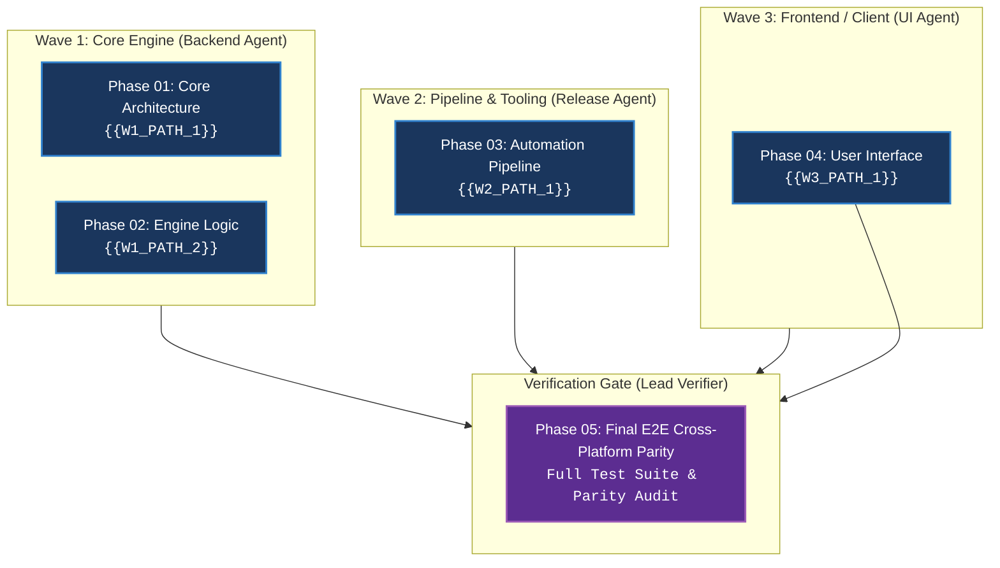

# {{SUITE_TITLE}} — Master PRD

**Target Repositori:** `{{TARGET_PATH}}`  
**Stack Teknologi:** {{TECH_STACK}}  
**Author:** {{AUTHOR_NAME}} & Lead Orchestrator  
**Current Version:** `{{CURRENT_VERSION}}`  
**Target Release Version:** `{{TARGET_RELEASE_VERSION}}` ({{BUMP_TYPE}} — {{ONE_LINE_SCOPE}})  
**Status:** 🟡 PROPOSED / 🔄 IN PROGRESS ({{COMPLETED_PHASES}}/{{TOTAL_PHASES}} PHASES COMPLETED) / ✅ COMPLETED  
**Target Delivery:** Multi-Phase Modular Architecture  
**Confidence Score:** {{CONFIDENCE_SCORE}}%  
**Baseline Audit Reference:** [{{AUDIT_DOCUMENT_ID}}]({{RELATIVE_PATH_TO_AUDIT_DOC}}) _(format ID: `AUDIT-YYYY-MM-DD-<slug>-hhmm`, cth. `AUDIT-2026-09-25-lead-orchestrator-1830`)_  
**Created:** {{CREATION_DATE}} _(format: YYYY-MM-DD HH:MM (UTC±X) — waktu lokal penulis + offset UTC, cth. 2026-09-17 15:30 (UTC+7). MANDATORY: query live OS clock FIRST via `date "+%Y-%m-%d %H:%M (UTC%z)"` (POSIX/Git Bash) or `Get-Date -Format "yyyy-MM-dd HH:mm (UTC+7)"` (PowerShell/Windows), then substitute the placeholder — NEVER invent datetime values.)_  
**Completed Date:** {{COMPLETION_DATETIME}} _(format: YYYY-MM-DD HH:MM (UTC±X) — waktu lokal penulis + offset UTC, cth. 2026-09-17 20:50 (UTC+7) — wajib diisi saat ✅ COMPLETED. MANDATORY: query live OS clock FIRST via `date "+%Y-%m-%d %H:%M (UTC%z)"` (POSIX/Git Bash) or `Get-Date -Format "yyyy-MM-dd HH:mm (UTC+7)"` (PowerShell/Windows), then substitute the placeholder — NEVER invent datetime values.)_  
**Duration:** {{DURATION}} _(otomatis = Completed − Created; <1 jam → Xm Ys; <1 menit → Ys)_  
**Last Updated:** {{LAST_UPDATED_DATE}} _(format: YYYY-MM-DD HH:MM (UTC±X) — waktu lokal penulis + offset UTC, cth. 2026-09-17 20:50 (UTC+7). MANDATORY: query live OS clock FIRST via `date "+%Y-%m-%d %H:%M (UTC%z)"` (POSIX/Git Bash) or `Get-Date -Format "yyyy-MM-dd HH:mm (UTC+7)"` (PowerShell/Windows), then substitute the placeholder — NEVER invent datetime values.)_  
**Verification Verdict:** {{VERIFICATION_VERDICT}}  
**Next Milestone:** {{NEXT_MILESTONE}}  
**Primary Keywords:** {{PRIMARY_KEYWORDS}}  

---

## 🎯 1. Executive Summary & Root Cause Analysis

### Konteks & Masalah Utama (Current Pain Points)
1. **{{PAIN_POINT_1_TITLE}}**: {{PAIN_POINT_1_DESC}}
2. **{{PAIN_POINT_2_TITLE}}**: {{PAIN_POINT_2_DESC}}
3. **{{PAIN_POINT_3_TITLE}}**: {{PAIN_POINT_3_DESC}}

### Visi Arsitektur Solutif (Desired End State)
1. **{{DESIRED_STATE_1_TITLE}}**: {{DESIRED_STATE_1_DESC}}
2. **{{DESIRED_STATE_2_TITLE}}**: {{DESIRED_STATE_2_DESC}}
3. **{{DESIRED_STATE_3_TITLE}}**: {{DESIRED_STATE_3_DESC}}

---

## 🗺️ 2. Lead Orchestrator Command Map & Governance Pillars (MANDATORY WORKFLOW)

Setiap inisiatif rekayasa perangkat lunak wajib dipandu secara otonom melalui Lead Orchestrator Command Map untuk menjamin eksekusi cepat, efektif, efisien, presisi, dan sesuai target:

```text
                      ┌─────────────────────────────────────────┐
                      │     LEAD ORCHESTRATOR COMMAND MAP       │
                      └─────────────────────────────────────────┘
                                           │
         ┌──────────────────┬──────────────┴──────────────┬──────────────────┐
         ▼                  ▼                             ▼                  ▼
  [1. ARCHITECT]     [2. DISPATCHER]               [3. WATCHDOG]      [4. GATEKEEPER]
  Menyusun DAG,      Memetakan wave,               Memantau SLA,      Memanggil Verifier,
  membagi file       mendelegasikan                mencegah loop,     menolak wave cacat
  air-gapped         ke sub-agent                  re-route gagal     sebelum unblock
         │                  │                             │                  │
         └──────────────────┼─────────────────────────────┼──────────────────┘
                            ▼                             ▼
                    [5. COMMIT MASTER]            [6. RECONCILER]
                    Memastikan commit             Update PRD status,
                    atomik per-phase              CHANGELOG & Kanban
```

### 6 Pilar Otoritatif Lead Orchestrator:
1. **Architect & Topologist**: Menganalisis ground-truth codebase (AST & disk), membagi file boundaries secara air-gapped (`Target Modul / File:`), dan menyusun DAG wave paralel tanpa risiko merge conflict.
2. **Task Dispatcher & Scoper**: Menyusun prompt delegasi terfokus per spesialisasi persona (`executor`, `planner`, `critic`, `debugger`, `verifier`), dilarang mengirimkan mega-prompt monolitik yang membuang context window.
3. **Proactive Watchdog & Circuit Breaker**: Memantau heartbeat sub-agent tiap 3 menit (Zero Dormant Waiting), menerapkan **2-Strike Rule** (abort & re-route jika error berulang 2x), dengan hard timeout SLA 15 menit.
4. **Hard Gate 3 Gatekeeper (Zero Unverified Progression)**: Wajib men-spawn sub-agent `verifier` independen setelah setiap wave selesai untuk menguji build, lint, dan unit test. Membuka gembok wave berikutnya HANYA jika 100% PASS.
5. **Atomic Commit Master (Phase Commit Enforcer)**: Mewajibkan eksekusi git commit atomik lokal (`git add <files> && git commit -m "feat(...): ... (phase-XX)"`) segera setelah fase/wave terverifikasi lolos uji, sebelum berpindah ke fase berikutnya.
6. **Release & Governance Reconciler**: Menyelaraskan SemVer (`Current` vs `Target Release Version`), men-generate entri `CHANGELOG.md` berformat waktu lokal `YYYY-MM-DD HH:MM (UTC±X)`, memperbarui Kanban Tab 4 (*Walkthrough*), dan menjalankan `just rules-sync`.

---

## 🎨 3. Visual & Interface Design: Before vs After (CLI & GUI Wireframes)

### [KATEGORI A: Fitur CLI / Backend / Daemon / Engine]
#### ❌ BEFORE (Legacy Command & Output):
```text
{{LEGACY_CLI_OUTPUT}}
```

#### ✅ AFTER (Modern Command with ASCII Banner & Tips):
```text
{{MODERN_CLI_OUTPUT}}
```

---

### [KATEGORI B: Fitur Web GUI / Frontend / Mobile Component]
#### Layout Desktop Responsive (Widescreen)
```text
+--------------------------------------------------------------------------------------------------+
|  {{APP_TITLE}}                                                             [User Profile]        |
+--------------------------------------------------------------------------------------------------+
|  [Navigation Container]                                                                          |
|                                                                                                  |
|  +--------------------------------------------------------------------------------------------+  |
|  |  {{CARD_TITLE}}                                                           [Status Badge]   |  |
|  +--------------------------------------------------------------------------------------------+  |
|  |  • Metric / Scope 1: {{METRIC_1}}                                                          |  |
|  |  • Metric / Scope 2: {{METRIC_2}}                                                          |  |
|  +--------------------------------------------------------------------------------------------+  |
+--------------------------------------------------------------------------------------------------+
```

---

## 🌊 3. Parallel Multi-Agent Execution Waves (DAG Matrix)

> Pilih SALAH SATU pola (wajib eksplisit di tabel fase):
> - **Contract-First (vertical slice, multi-domain):** Wave 1 = Freeze Contracts & DDL (blocking) → Wave 2A (Backend) + Wave 2B (Frontend) paralel di atas kontrak beku → Wave 3 = Wiring & E2E. Lihat `prd-blueprint-standard.md` §4a.
> - **Air-Gapped (single-domain):** partisi per batas file eksklusif seperti DAG di bawah.



---

## 📋 4. Sub-Phase Breakdown Table (Air-Gapped Boundaries)

| Phase | Title | File Plan | Target File Boundaries (Air-Gapped) | Parallel Wave | Status |
|---|---|---|---|---|---|
| **Phase 01** | {{PHASE_1_TITLE}} | `phase-01-{{PHASE_1_SLUG}}.md` | `path/to/module_a/*` | **Wave 1 (Backend)** | 🟡 Ready |
| **Phase 02** | {{PHASE_2_TITLE}} | `phase-02-{{PHASE_2_SLUG}}.md` | `path/to/module_b/*` | **Wave 1 (Backend)** | 🟡 Ready |
| **Phase 03** | {{PHASE_3_TITLE}} | `phase-03-{{PHASE_3_SLUG}}.md` | `path/to/pipeline/*` | **Wave 2 (Release)** | 🟡 Ready |
| **Phase 04** | {{PHASE_4_TITLE}} | `phase-04-{{PHASE_4_SLUG}}.md` | `apps/web/src/*` | **Wave 3 (UI)** | 🟡 Ready |
| **Phase 05** | Final E2E Verification & Parity | `phase-05-verification.md` | Verification Gate (Test suite, E2E, Leak Scan) | **Final Gate** | 🔲 Blocked by W1-W3 |

---

## 🗂️ 5. Comprehensive Directory & Codebase Impact Tree (Blast Radius Map)

```text
{{PROJECT_ROOT}}/
├── path/to/
│   ├── new_file.ext                           # [NEW] Deskripsi modul baru
│   └── modified_file.ext                      # [MODIFIED] Deskripsi refactoring
└── deprecated/
    └── old_file.ext                           # [DEPRECATED/PURGED] Alasan dipensiunkan
```

---

## 🎯 6. Measurable KPIs & Success Criteria (MANDATORY)

| Dimensi | Parameter Target | Baseline (Before) | Target Sukses (After) | Cara Verifikasi (*Verification Method*) |
|---|---|---|---|---|
| **Performance / Latency** | {{PERF_PARAM}} | {{PERF_BASELINE}} | {{PERF_TARGET}} | {{PERF_VERIFICATION}} |
| **Code Budget / Quality** | {{CODE_PARAM}} | {{CODE_BASELINE}} | {{CODE_TARGET}} | {{CODE_VERIFICATION}} |
| **Error Rate / Reliability** | {{RELIABILITY_PARAM}} | {{RELIABILITY_BASELINE}} | {{RELIABILITY_TARGET}} | {{RELIABILITY_VERIFICATION}} |
| **Visual / Contract Parity** | {{PARITY_PARAM}} | {{PARITY_BASELINE}} | {{PARITY_TARGET}} | {{PARITY_VERIFICATION}} |

---

## 🧪 7. Concrete End-to-End Test Scenarios (MANDATORY)

### Skenario 1: {{SCENARIO_1_TITLE}} (Happy Path / Primary Flow)
1. **Given**: {{SCENARIO_1_GIVEN}}
2. **When**: {{SCENARIO_1_WHEN}}
3. **Then**:
   - {{SCENARIO_1_THEN_1}}
   - {{SCENARIO_1_THEN_2}}

### Skenario 2: {{SCENARIO_2_TITLE}} (Error Boundary & Resilience)
1. **Given**: {{SCENARIO_2_GIVEN}}
2. **When**: {{SCENARIO_2_WHEN}}
3. **Then**:
   - {{SCENARIO_2_THEN_1}}
   - {{SCENARIO_2_THEN_2}}

---

## 📦 8. Artifact Contract & Verification Matrix (Input ➔ Action ➔ Evidence)

| Wave & Phase | Input Artefak | Tindakan Eksekusi Agen | Output & Bukti Terverifikasi (*Verifiable Evidence*) |
|---|---|---|---|
| **Wave 1: Phase 01** | `{{PHASE_1_INPUT}}` | Implementasi TDD RGR | Unit test 100% pass; 0 compiler errors; zero regression. |
| **Wave 2: Phase 03** | `{{PHASE_3_INPUT}}` | Automated pipeline build | Build artifacts generated cleanly; exit code 0. |

---

## 🛡️ 9. Failure Modes, Edge Cases & Autonomous Recovery Playbook

1. **Failure Mode 1: {{FAILURE_SCENARIO_1}}**
   - *Penyebab*: {{CAUSE_1}}
   - *Aksi Mandiri Agen*: {{AUTONOMOUS_ACTION_1}}
2. **Failure Mode 2: {{FAILURE_SCENARIO_2}}**
   - *Penyebab*: {{CAUSE_2}}
   - *Aksi Mandiri Agen*: {{AUTONOMOUS_ACTION_2}}

---

## 🛑 10. Hard Governance Rules & OPSEC
1. **Zero Secret Leak**: Semua secret, token, dan kunci privat wajib melalui environment variable terenkripsi.
2. **Zero Console Flashing**: Di Windows, semua subprocess wajib menggunakan `executil.HideWindow` / `CREATE_NO_WINDOW`.
3. **Strict Air-Gapped Wave Boundaries**: Agen yang bekerja paralel di wave berbeda dilarang memodifikasi file yang sama secara bersamaan.
4. **Session-Isolated Watchdog**: Orchestrator memantau subagent dengan SLA 15 menit, probe heartbeat tiap 3 menit (Zero Dormant Waiting), dan terisolasi per `CLAUDE_SESSION_ID`.
<!-- ACS workflow v1.6.1+317323e -->
<!-- ACS workflow v1.33.0+c2a90b3 -->
