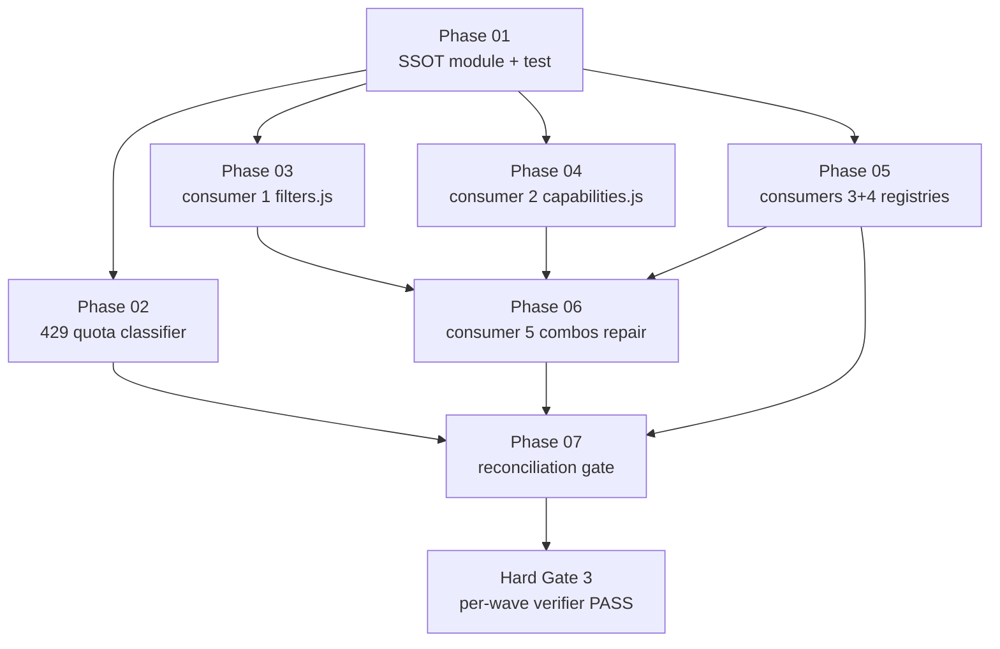

# PRD Blueprint — OpenCode Free-Model Catalog SSOT

## 1. Structured Metadata Header

| Field | Value |
|---|---|
| Target Repository | `C:/Users/andyvand/Dev/personal/agnostic/04-reference-repos/9router` |
| Technology Stack | Plain JavaScript ESM (no TypeScript), Next.js App Router, `@/*` -> `src/*`, SQLite (`src/lib/db/`), vitest under `tests/` (independent ESM package) |
| Author | Andy Vandaric & Lead Orchestrator (architect persona: Daan) |
| Current Version | `v0.5.111` |
| Target Release Version | `v0.6.0` (minor: new SSOT module + consumer migration; no contract break) |
| Status | DRAFT — awaiting Hard Gate 1 re-audit, then Hard Gate 2 user approval |
| Target Delivery | 2026-10-29 (7 phases, 4 waves) |
| Created | 2026-10-22 |
| Duration | 5-7 working days |
| Last Updated | 2026-10-22 |
| Verification Verdict | NOT YET VERIFIED — problem evidence is authoritative (E1-E10, live-probed 2026-10-22); solution still needs phase-level verification |
| Next Milestone | Hard Gate 1: independent re-audit of this index against live disk AST |
| Primary Keywords | `free-model-ssot`, `(lane,modelId)`, `six-state-enum`, `drift`, `egress-rotation`, `quota-429`, `combo-repair` |

## 2. 🎯 Executive Summary & Strategic Vision

Upstream adoption is a non-goal: `git diff --name-status master upstream/master` = **66 D, 39 M, 0 A** — upstream has no file master lacks (E1). The real defect is that FREE-model knowledge is scattered across **FIVE hand-maintained lists** that drift independently and contradict an upstream **already fetched** by three `modelsFetcher` wirings (E1).

The catalog infrastructure already exists — `open-sse/providers/catalogOverride.js` (mtime-cached `load()` at L32-50), `src/lib/modelCatalog/sync.js` (daily refresh), `src/app/api/models/catalog-sync/route.js` (E1). What is missing is a **free-model SSOT** keyed on `(lane, modelId)`, because liveness is a property of the pair, not the id (E2): `big-pickle` is free-lane only; `beam-free` is on all three; the go lane serves `muse-spark-1.3-contributor` while the free lane returns 410 for the `-free` form.

Vision: one mtime-cached SSOT that classifies every free `(lane, id)` into a **six-state enum** (`ALIVE`, `QUOTA_BLOCKED`, `DEPRECATED`, `FINGERPRINT_BLOCKED`, `PROTOCOL_UNSUPPORTED`, `DEAD_UPSTREAM`, plus `UNKNOWN`) with `deadReason` and `lastVerified` (E3), and all five consumers read from it instead of keeping their own truth. A binary alive/dead model misclassifies four of six states (E3) — that is the bug class this blueprint eliminates.

**Component Tree (SSOT + its FIVE consumers)**

```
open-sse/providers/freeModelCatalog.js        <-- NEW SSOT (lane,modelId) -> state
├── CONSUMER 1  src/app/api/providers/suggested-models/filters.js     (E4.1)
├── CONSUMER 2  open-sse/providers/capabilities.js                    (E4.2)
├── CONSUMER 3  open-sse/providers/registry/opencode.js               (E4.3)
├── CONSUMER 4  open-sse/providers/registry/opencode-zen.js           (E4.4)
└── CONSUMER 5  live DB `combos` table -> combo repair path           (E4.5)
```

**Explicit Non-Goals**
1. No upstream merge/rebase (E1: 0 added files).
2. No new DB tables, no DDL — the `combos` table is user-facing and stores JSON arrays (E10).
3. No change to the `strictProxy` contract in `open-sse/utils/proxyFetch.js` (E7).
4. No TypeScript migration, no `EnterPlanMode`, no hand-edit of the auto-generated `open-sse/providers/registry/index.js` (E10).
5. No gateway-layer IP rotation: `src/sse/services/auth.js` L93 defaults `rotateStrategy` to `"none"`; egress rotation stays inside the existing path (E6).

## 3. 🎨 Visual & Interface Design: Before vs After

```
  ┌──────────────────────────────────────────────────────────────────────┐
  │   FIVE DRIFT SITES  ──X──>  ONE SSOT  ──>  five consumers            │
  │   (lane,modelId) · six states · deadReason · lastVerified            │
  └──────────────────────────────────────────────────────────────────────┘
```

**BEFORE — free-model knowledge (five divergent sources, live probe 2026-10-22)**

```
$ curl -s localhost:20128/v1/models | jq -r '.[].id' | grep '^oc/'
oc/deepseek-v4.1-flash-free
oc/jev-1.13-free
oc/mimo-v2.6-flash-free
oc/glm-5.3-flash-free
oc/minimax-m3.1-flash-free        <-- PHANTOM: upstream-absent, returns 410
oc/flint-40b-free
oc/big-pickle
# MISSING (published upstream, not exposed): beam-free,
#   nemotron-3.5-super-vl-free, nemotron-3.5-lightning-free

$ curl -s -X POST localhost:20128/v1/chat/completions -d '{"model":"muse"}'
HTTP 410 ModelDeprecated
$ curl -s -X POST localhost:20128/v1/chat/completions -d '{"model":"1st_combo"}'
HTTP 410 ModelDeprecated
```

**AFTER — one SSOT-backed set (target state)**

```
$ node -e "import('./open-sse/providers/freeModelCatalog.js').then(m=>console.log(m.describe()))"
lane=inference  big-pickle                 ALIVE
lane=inference  beam-free                  FINGERPRINT_BLOCKED  (403 fingerprint)
lane=inference  nemotron-3.5-super-vl-free FINGERPRINT_BLOCKED
lane=inference  jev-1.13-free              PROTOCOL_UNSUPPORTED (wrong lane: systemone)
lane=inference  minimax-m3.1-flash-free    DEPRECATED  -> use deepseek-v4.1-flash-free
lane=zen        muse-spark-1.3-contributor-free DEPRECATED
lane=go         muse-spark-1.3-contributor      ALIVE  (substitute for the 410 free form)

$ curl -s localhost:20128/v1/models | jq -r '.[].id' | grep '^oc/'
# zero phantom ids; zero missing published free ids
```

## 4. 🌊 Parallel Multi-Agent Execution Waves (DAG Matrix)



| Wave | Phases | Parallel? | Blocker |
|---|---|---|---|
| W1 | 01 | sequential | none — SSOT schema is the upstream dependency of everything |
| W2 | 02, 03, 04, 05 | 4-way parallel | all blocked by Phase 01 |
| W3 | 06 | sequential | blocked by 03, 04, 05 (needs consumer view + live-substitute lookup) |
| W4 | 07 | sequential | blocked by 02 and 06 |

**Dependency / Blocker Map:** `01 -> {02,03,04,05}`; `{03,04,05} -> 06`; `{02,06} -> 07`. W2 phases share NO file, so they are air-gapped. Phase 07's proxy `cause` micro-chunk (E7) is independent of the catalog work and may run inside W4 as its own chunk.

## 5. 📋 Sub-Phase Breakdown Table (Air-Gapped Boundaries)

| Phase | Title | File Plan | Target File Boundaries (Air-Gapped) | Parallel Wave | Status |
|---|---|---|---|---|---|
| 01 | Free-model SSOT module | `open-sse/providers/freeModelCatalog.js` (new) + `tests/unit/free-model-catalog.test.js` (new) | ONLY those 2 files. Mirror `catalogOverride.js` L32-50 mtime cache. Key `(lane, modelId)`; 6-state enum + `UNKNOWN`; `deadReason`; `lastVerified`. | W1 | TODO |
| 02 | 429 quota classifier + bounded retry | `open-sse/utils/freeTierEgress.js` (L16 `FREETIER_KIND`, L47-54 classifier), `open-sse/config/errorConfig.js` (L59-83 `ERROR_RULES`), `open-sse/executors/opencode.js` (L433-439 site; L445-473 pattern; `MAX_EGRESS_ATTEMPTS` L32), `tests/unit/free-tier-egress-classify.test.js` | ONLY those 4 files. Add `FREETIER_KIND.quota` for the 429 `FreeUsageLimitError` body; add a text rule before the `{status:429}` fallback; give the quota path its OWN bounded counter (`MAX_QUOTA_ATTEMPTS = 3`) so the 403 egress block stays byte-identical. NOTE the L445-473 pattern retries the SAME egress — it does not rotate the node (phase-02 DD-02-1 records this as a named verification step). | W2 | TODO |
| 03 | Migrate consumer 1 — dashboard filters | `src/app/api/providers/suggested-models/filters.js` + its test | ONLY those 2 files. Delete `KNOWN_FREE_OPENCODE_MODELS` (L4) and `DEAD_FREE_OPENCODE_MODELS` (L7); read SSOT. | W2 | TODO |
| 04 | Migrate consumer 2 — capability table | `open-sse/providers/capabilities.js` + its test | ONLY those 2 files. Drop the 9 stale free rows, narrow the over-broad `*muse*spark*` pattern, and resolve the missing upstream free ids by triage (the evidenced add-set is 1: `nemotron-3.5-super-vl-free`; the other 7 need NO row — absence is correct). The 2 `muse-*-free` rows must stop declaring `contextWindow: 1048576` for 410 models. | W2 | TODO |
| 05 | Migrate consumers 3+4 — registries | `open-sse/providers/registry/opencode.js`, `open-sse/providers/registry/opencode-zen.js` + tests | ONLY those 4 files (hand-written, editable — E10). Fix `x-opencode-client: "desktop"` -> `"cli"` (L18/L50 vs executor L23); drop the L38-41 false comment and the stale `forceAutoToolChoiceModels` (L30); drop zen's 6 stale ids (L108-121); do NOT add `big-pickle` (zen lane does not publish it — see P05 DD-4, supersedes the earlier wording here). | W2 | TODO |
| 06 | Migrate consumer 5 — combo repair | `src/lib/db/repair/opencodeComboRepair.js` (NEW — no repair path exists on disk) + `tests/unit/combo-repair.test.js` (NEW) | ONLY those 2 files. REPOINT the 5 stale combo leads via `resolveLiveSubstitute` (go-lane `muse-spark-1.3-contributor`); REUSE `combosRepo.updateCombo` L53-67; NO DDL; idempotent (zero UPDATE on a second run); abort before any write if the catalog is EMPTY. | W3 | TODO |
| 07 | Reconciliation gate + proxy `cause` fix | `open-sse/utils/proxyFetch.js` (L460/L462, L484/L487, L489-490, L504-510 — all verified no-drift) + `tests/unit/free-catalog-five-way-agreement.test.js` (NEW) + `tests/unit/proxy-health-probe.test.js` (AMEND) | ONLY those 3 files. Assert all FIVE consumers agree with SSOT; `/v1/models` `oc/` set has 0 phantom / 0 missing; preserve `proxyError.cause` (both strict throws drop it today), ONE bounded retry for connect-level codes only. | W4 | TODO |

**Phase Execution Notes (RGR · micro-chunks · DoD · blockers)**

- **Every phase DoD is "0 NEW failures against the E9 baseline" (326 passed / 44 failed of 386 files; 3674 passed / 96 failed of 3883 tests), NOT "all green".** Compare with `tests/__baseline__/verify-no-regression.mjs`. Run focused: `cd tests && npx vitest run unit/<file>`.
- **P01** — RGR: RED `free-model-catalog.test.js` asserting `(lane,modelId)` keying and that `beam-free` on lane `inference` != lane `go`; GREEN minimal reader. Chunks: (1) module+test, (2) mtime-cache assertion. DoD: 6-state + `UNKNOWN` covered; `deadReason` populated for DEPRECATED/DEAD_UPSTREAM. Blockers: none.
- **P02** — RGR: RED assert a 429 `FreeUsageLimitError` body classifies as `FREETIER_KIND.quota` (today `freeTierEgress.js` classifies 403 only — E6); GREEN rule + egress rotation. Chunks: (1) classifier+rule, (2) executor L433-439 swap. Green baseline for this phase: 24/24 in 1.85 s across `free-tier-egress-classify`, `opencode-egress-retry`, `model-catalog-scope`. Blockers: P01 not required, but keep rule text in `errorConfig.js` ordered before `{status:429}`.
- **P03** — RGR: RED assert `"opencode-free"` filter yields SSOT ALIVE ids only; GREEN swap. Chunks: (1) filters+test. Also the E8 SSRF hardening note (host allowlist, reject loopback/link-local/RFC1918) belongs to this phase's route scope. Blockers: P01.
- **P04** — RGR: RED assert no free row exists for a stale id and every upstream free id either resolves through the pattern/catalog layer or carries an audited row; GREEN table edit. Chunks: (1) prune 9 stale + narrow the muse pattern, (2) retrofit the existing capability test, (3) triage the missing upstream ids (evidenced add-set = 1). Blockers: P01.
- **P05** — RGR: RED assert registry free list == SSOT free list per lane; GREEN registry edits. Chunks: (1) `opencode.js` (models + quirk + header), (2) `opencode-zen.js`. Never hand-edit `registry/index.js` (E10). Blockers: P01.
- **P06** — RGR: RED assert each of the 5 stale combos resolves to a live `(lane,id)` after repair; GREEN repoint. Chunks: (1) repair path+test. Blockers: P03, P04, P05.
- **P07** — RGR: RED five-way agreement test + `oc/` set equality test + proxy `cause` test; GREEN reconciliation + `proxyFetch.js` fix. Chunks: (1) reconciliation test, (2) proxy `cause` micro-chunk. `strictProxy` must not be weakened; still throw immediately for `ERR_PROXY_DNS_MODE` (L484, L460) and never fall back to direct egress. Blockers: P02, P06.

## 6. 🎯 Measurable KPIs & Success Criteria

| Dimension | Target Parameter | Baseline (Before) | Success Target (After) | Verification Method |
|---|---|---|---|---|
| SSOT coverage | free `(lane,id)` pairs classified | 0 (no SSOT) | 100% of the 9 free-lane + 8 zen + 1 go ids classified | `unit/free-model-catalog.test.js` |
| State fidelity | distinct free states modelled | 2 (alive/dead) | 6 + `UNKNOWN` | classifier unit test |
| Drift sites | hand-maintained free lists | 5 | 0 (all read SSOT) | P07 five-way agreement test |
| Phantom exposure | `oc/` ids on `/v1/models` absent upstream | 1 (`oc/minimax-m3.1-flash-free`) | 0 | live `GET :20128/v1/models` vs SSOT |
| Missing exposure | published free ids not exposed | 3 (`beam-free`, `nemotron-3.5-super-vl-free`, `nemotron-3.5-lightning-free`) | 0 | same as above |
| Quota handling | 429 `FreeUsageLimitError` classified | not classified (403-only) | classified `quota`; retry rotates EGRESS | `unit/free-tier-egress-classify.test.js` |
| Combo health | combos leading with a 410 id | 5 (`1st_combo`, `muse`, `muse-spark-1.3-contributor`, `mimo-v2.6-flash`, `gemini-3.1-pro-max`) | 0 | live `POST /v1/chat/completions` -> HTTP 200 |
| Proxy diagnostics | `cause` preserved on strict-proxy throw | dropped (L462, L487) | preserved; 1 bounded hop retry | `unit/proxy-health-probe.test.js` + new guard |
| Regression | new test failures vs baseline | 96 failed / 3883 (E9) | 0 NEW failures | `tests/__baseline__/verify-no-regression.mjs` |
| LOC discipline | file size | varies | warn 300 / block 500; fn <=50 lines, <=3 nesting | lint + review |

## 7. 🧪 Concrete End-to-End Test Scenarios

**S1 — Liveness is a `(lane,id)` property, not an id property**
- Given the SSOT loaded from the three upstream lanes (E2)
- When `getState("inference", "big-pickle")` and `getState("zen", "big-pickle")` are queried
- Then `inference` is `ALIVE` and `zen` is absent/`UNKNOWN`, and `beam-free` is `ALIVE` on `go` while `FINGERPRINT_BLOCKED` on `inference`.

**S2 — 429 quota rotates egress, not session**
- Given `oc/deepseek-v4.1-flash-free` returns 429 `FreeUsageLimitError` on the current IP (measured 1 OK / 3 FAIL over 4 rounds, then OK after rotation — E3)
- When `open-sse/executors/opencode.js` handles that response
- Then the response classifies as `FREETIER_KIND.quota`, the retry rotates EGRESS via the L445-473 pattern, and it does NOT merely `evictStableSession` + `continue`.

**S3 — Dashboard never offers a dead id**
- Given `filters.js` no longer holds `KNOWN_FREE_OPENCODE_MODELS` / `DEAD_FREE_OPENCODE_MODELS` (E4.1)
- When the `"opencode-free"` filter is applied
- Then it yields only SSOT `ALIVE` ids, and `oc/minimax-m3.1-flash-free` is absent.

**S4 — Stale combo REPOINTS instead of deleting**
- Given the 5 combos leading with a 410 id (E4.5), where `muse-spark-1.3-contributor-free` is 410 but go-lane `muse-spark-1.3-contributor` is live (E5)
- When the repair runs
- Then each combo's lead is repointed to a live `(lane,id)`, the combo still exists, and `POST /v1/chat/completions` with `model=muse` returns HTTP 200.

**S5 — Proxy strict throw preserves the discriminating cause**
- Given `strictProxy=true` and a proxy-hop connect failure (measured 5.6% over 107 attempts, E7)
- When `proxyFetch.js` L462/L487 throws
- Then `error.cause` still carries `ECONNREFUSED`/`ECONNRESET`/`ETIMEDOUT`, exactly ONE bounded retry is attempted for connect-level hop failures, and `ERR_PROXY_DNS_MODE` still throws immediately with no direct-egress fallback.

## 8. 📦 Artifact Contract & Verification Matrix

| Wave & Phase | Input Artifact | Agent Execution Action | Verifiable Evidence |
|---|---|---|---|
| W1 · P01 | This index §5 P01; `catalogOverride.js` L32-50 as the cache pattern | Author `freeModelCatalog.js` + test (RED -> GREEN) | `cd tests && npx vitest run unit/free-model-catalog.test.js` green |
| W2 · P02 | SSOT module; `freeTierEgress.js`; `errorConfig.js` L59-83; executor L433-439 | Add `quota` kind + rule; swap session->egress rotation | 24/24 across `free-tier-egress-classify`, `opencode-egress-retry`, `model-catalog-scope` |
| W2 · P03 | SSOT module; `filters.js` L4/L7/L21-24 | Delete hardcoded constants; read SSOT | `"opencode-free"` filter test green; no dead id offered |
| W2 · P04 | SSOT module; `capabilities.js` 12 free rows | Prune 9 stale; narrow the muse pattern; triage the missing ids (add-set = 1) | capability test green; no 1 MiB context claim on a 410 model |
| W2 · P05 | SSOT module; both registry files | Fix header `desktop`->`cli`; drop stale quirk + false comment | registry test green; `x-opencode-client: "cli"` asserted |
| W3 · P06 | SSOT live-substitute lookup; live `combos` DB | Repoint 5 stale combos; no DDL | live `POST /v1/chat/completions` `model=muse` -> 200 |
| W4 · P07 | All five consumers; `proxyFetch.js` L462/L487 | Five-way agreement test; `/v1/models` set equality; preserve `cause` | P07 tests green; `verify-no-regression.mjs` shows 0 NEW failures; Hard Gate 3 verifier PASS |

**Confidence Score: 88%.** Honest split: the PROBLEM is very well evidenced (E1-E10, live-probed on disk and against live upstreams 2026-10-22, with file:line for every drift site and measured HTTP status codes). The SOLUTION still needs phase-level verification — the SSOT schema shape is sound but unproven against real upstream churn, the combo-repair path file is not yet named, and the 429 egress-rotation change touches live retry semantics. Phase 01 will raise this materially.

**Open Questions (deliberately unresolved — do not invent answers)**
1. **Combo-repair file path**: E4.5 names the `combos` table and the 5 combos, but no source file for the repair path is listed. Phase 06 must confirm the path before its RED test.
2. **SSOT persistence**: whether the SSOT is a pure in-memory mtime-cached reader (mirroring `catalogOverride.js`) or writes a snapshot to disk. E1 implies in-memory; a daily refresh (`modelCatalog/sync.js`) may want a snapshot. Unresolved.
3. **`QUOTA_BLOCKED` cooldown duration**: E3 measures 1 OK / 3 FAIL then recovery, but no cooldown constant is given. `getQuotaCooldown(egressAttempt)` exists (E6) — its suitability for the quota case is unverified.
4. **`PROTOCOL_UNSUPPORTED` routing**: `jev-1.13-free` is `{kind:"systemone"}` on `.../inference/v1/systemone` (E3). Whether the SSOT should mark it ALIVE-on-other-lane or PROTOCOL_UNSUPPORTED-on-this-lane is a policy choice left open.
5. **E8 SSRF hardening scope**: the host allowlist source is "the provider registry's known catalog URLs" — the exact accessor for that registry list is not named in E8.
6. **Non-free ids**: the free lane carries 76 non-free ids plus junk (`test`, `claude-opus-5-5-backup`); the filter predicate is required but unspecified.
